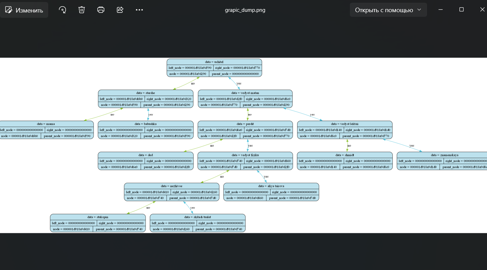
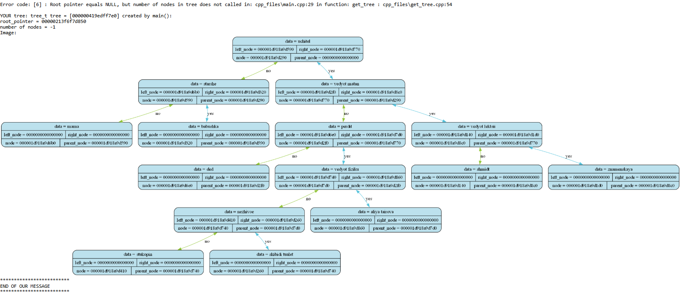

# AKINATOR BASED ON A BINARY TREE

### This program simulates the work of an russian akinator program

## INSTRUCTIONS

**To launch the program, you need to:**

1. Create folder for programm

2. Choose data type for your list and write it in bat file. You have options:

1. TREE_USE_INT
2. TREE_USE_DOUBLE
3. TREE_USE_CHAR

> [!NOTE]
> This program doesn't have memory arena. To create new node calloc is used each time.

> [!TIP]
> There is no difference between each mode yet, so we use calloc each time to create data for node.

3. Some akinator modes use stack [Stack On My GitHub](https://github.com/pso11/Stack). Do not forget to write type of stack data.
```C
typedef struct tree_node_t* stack_elem_t;
```

> [!NOTE]
> The stack stores pointers to nodes in the tree.

3. Write name for your database file in bat file.

> [!NOTE]
> If you do not want to combine compilation and launch, do not forget to write yur file name
> ```C
> .\akinator.exe database.txt
>```

4. Run bat file
```C
PS D:\C\Akinator> .\akinator.bat
```

<details>
<summary>EXAMPLE OF BAT FILE:</summary>

```C
g++ -g -DTREE_USE_CHAR -DSTACK_USE_CHAR_POINT -DTREE_DEBUG cpp_files\main.cpp cpp_files\main_functions.cpp cpp_files\get_tree.cpp cpp_files\guess_mode.cpp cpp_files\dump.cpp cpp_files\define_mode.cpp cpp_files\compare_mode.cpp cpp_files\show_tree.cpp  cpp_files\txSpeak.cpp ..\Stack\stack.cpp -Ih_files -I..\Stack -o akinator.exe ^
-finput-charset=UTF-8 -fexec-charset=UTF-8 -Wshadow -Winit-self -Wredundant-decls -Wcast-align -Wfloat-equal -Winline -Wunreachable-code ^
-Wmissing-declarations -Wno-redundant-tags -Wmissing-include-dirs -Wswitch-enum -Wswitch-default -Weffc++ -Wmain -Wextra -Wall -g -pipe ^
-fexceptions -Wcast-qual -Wconversion -Wctor-dtor-privacy -Wempty-body -Wformat-security -Wformat=2 -Wignored-qualifiers ^
-Wlogical-op -Wno-missing-field-initializers -Wnon-virtual-dtor -Woverloaded-virtual -Wpointer-arith -Wsign-promo ^
-Wstack-usage=8192 -Wstrict-aliasing -Wstrict-null-sentinel -Wtype-limits -Wwrite-strings -Werror=vla -Wno-redundant-tags ^
-D_EJUDGE_CLIENT_SIDE

.\akinator.exe database.txt
```

</details>

## USAGE

**You have options of akinator mode**
```C
Привет, я Сири. Выберите режим работы программы
(1). Отгадывание              (2). Показать дерево
(3). Определение              (4). Сравнение
(5). Выйти
```
### Отгадывание (guessing)

> [!IMPORTANT]
> To answer in this mode you should use only "да" or "нет", if there is a wrong answer there is a message and new attemp to play.

**Example of guessing**
```C
Привет, я Сири. Выберите режим работы программы
(1). Отгадывание              (2). Показать дерево
(3). Определение              (4). Сравнение
(5). Выйти
1
Это учитель?
да
Это Ведёт матан?
да
Это ведёт лекции?
да
Это знаменская?
да
Уафхфхфххф, я же говорил, что угадаю
```
If he doesn't guess, you suggest him to add the object in question.

**Example of adding new node**
```C
Привет, я Сири. Выберите режим работы программы
(1). Отгадывание              (2). Показать дерево
(3). Определение              (4). Сравнение
(5). Выйти
1

Это учитель?
да
Это Ведёт матан?
нет
Это пердит?
да
Это ведёт физику?
нет
Это стукопин?
нет
Блиннн. Тогда что это было?:
скибиди туалет

Как скибиди туалет отличается от стукопин?:
неживое
```
**Example of wrong answer**
``` C
Привет, я Сири. Выберите режим работы программы
(1). Отгадывание              (2). Показать дерево
(3). Определение              (4). Сравнение
(5). Выйти
1

Это учитель?
да
Это Ведёт матан?
да
Это ведёт лекции?
даэ
Такого варианта ответа нет
Это ведёт лекции?
да
Это знаменская?
да

Уафхфхфххф, я же говорил, что угадаю
```
### Показать дерево (show tree)

> [!IMPORTANT]
> To show image of graphviz picture Windows will automatically find the application associated with the   .png extension and launch it.

**Example of show tree mode**


> [!IMPORTANT]
> Since our program uses txSpeak — which will be discussed further on — all files are encoded in 1251. This encoding is compatible with TXlib, but not with Graphviz. Therefore, we write the content for the Graphviz file using transliteration.

### Определение (definition)

> [!WARNING]
> If you enter a word with a space at the end, and it does not exist in the database, you will receive a notification stating that no such item exists.

**Example of definition**
```C
Привет, я Сири. Выберите режим работы программы
(1). Отгадывание              (2). Показать дерево
(3). Определение              (4). Сравнение
(5). Выйти
3

Введите определяемое слово: алия таирова

алия таирова учитель не Ведёт матан пердит ведёт физику
```

**Example of wrong data in definition**
```C
Привет, я Сири. Выберите режим работы программы
(1). Отгадывание              (2). Показать дерево
(3). Определение              (4). Сравнение
(5). Выйти
3
Введите определяемое слово: мама
Такого элемента не существует
```

### Сравнение (comparison)

> [!WARNING]
> If you enter a word with a space at the end, and it does not exist in the database, you will receive a notification stating that no such item exists.

**Example of comparison**
```C
Привет, я Сири. Выберите режим работы программы
(1). Отгадывание              (2). Показать дерево
(3). Определение              (4). Сравнение
(5). Выйти
4

Введите определяемое слово: мама
Введите определяемое слово: алия таирова

Схожеств нет
мама не учитель не старше
алия таирова учитель не Ведёт матан пердит ведёт физику
```
### Выйти (exit)

**You will complete the program execution cycle, and the database will be saved to your original file.**

## Voice-over

> [!IMPORTANT]
> If you have an older version of the compiler, you need to update it, as it will be missing an essential file — SAPI.h — required for txSpeak.

We use [TXLib](http://storage.ded32.net.ru/Lib/TX/TXUpdate/Doc/HTML.ru/index.htm)

Since the voice-over is generated for data from a **single file**, all the calls are stored within that file txSpeak.cpp

<details>
<summary>EXAMPLE OF FUNCTIONs IN THIS FILE:</summary>

```C
#include <stdio.h>
#include <stdlib.h>

#include "akinator.h"
#include "my_txSpeak.h"

int txSpeak_introduction(void)
{
    txSpeak("\vПривет, я Сири. Выберите режим работы программы  \n");

    return 0;
}

int txSpeak_empty_database(void)
{
    txSpeak("\vВаша база данных пуста.\n");

    return 0;
}

int txSpeak_main_charact(void)
{
    txSpeak("\vВведите главную характеристику: ");

    return 0;
}

int txSpeak_pros_answer(void)
{
    txSpeak("\vТеперь введите ответ, если да: ");

    return 0;
}
```
</details>

## DEBUG

You havee options:

1. WITH debug
2. WITHOUT debug

### ERROR CODES AND USAGE

You have only this errors for your programm
```C
    const char* error_description_array[] =
    {
        "Everything is OK",
        "Calloc didn't work",
        "You gave NULL pointer on tree structure",
        "You gave not existing node to the function",
        "You gave NULL pointer on file to function",
        "Couldn't open file",
        "Root pointer equals NULL, but number of nodes in tree does not",
        "Right node has wrong parent",
        "Left node has wrong parent",
        "Node has only one NULL baby",
        "Tree has cycle",
        "Root has not NULL parent",
        "Stack error -> check error code"
    };
```
It is an array, where per index of element corresponds to the number in the enum

```C
enum tree_error_t
{
    OK                        = 0,
    NULL_POINT_FROM_CALLOC    = 1,
    NULL_POINT_ON_TREE_STRUCT = 2,
    NULL_NODE_GIVEN           = 3,
    NULL_FILE_POINT           = 4,
    CANNOT_OPEN_FILE          = 5,
    WRONG_SIZE                = 6,
    WRONG_RIGHT_PARENTNESS    = 7,
    WRONG_LEFT_PARENTNESS     = 8,
    DAMAGED_LEAF_NODE         = 9,
    TREE_WITH_CYCLE           = 10,
    WRONG_ROOT_PARENT         = 11,
    DAMAGED_STACK_TREE        = 12
};
```

### EXAMPLE OF MAIN

```C
int main(const int argc, const char* argv[])
{
    SetConsoleCP(1251);
    SetConsoleOutputCP(1251);

    tree_error_t error_status = OK;
    tree_t tree = {};
    DUMP_INIT(tree);

    error_status = tree_init(&tree);
    ASSERT(tree, error_status);

    size_t chosen_mode = 0;
    while ((chosen_mode = ask_user_mode()) != 5)
    {
        error_status = get_tree(argv[1], &tree);
        ASSERT(tree, error_status);

        error_status = mode_array[chosen_mode - 1](&tree);
        ASSERT(tree, error_status);

        error_status = save_tree(argv[1], &tree);
        ASSERT(tree, error_status);

        error_status = tree_destroy(&tree, tree.tree_root);
        ASSERT(tree, error_status);

    }
    return 0;
}
```
### EXAMPLE OF TXT LOG

```C
*************************
MEET ERROR IN YOUR PROGRAMM READ ALL INFORMATION DOWN
*************************
Error code: [6] : Root pointer equals NULL, but number of nodes in tree does not called in: cpp_files\main.cpp:29 in function: get_tree : cpp_files\get_tree.cpp:54

YOUR tree: tree_t tree = [0000005d6fbff640] created by main():
root_pointer = 00000259fe43d560
number of nodes = -1
*************************
END OF OUR MESSAGE
*************************
```

### EXAMPLE OF HTML LOG



### **Hall of Fame**

• **Code Architect & Bug Factory: [[My GitHub link](https://github.com)]**

• **Code reviewer & motivator: [[sizeof.lj.ru](https://sizeof.livejournal.com)]**

• **Moral Support & Mental Stability: My playlist on Spotify**

• **Inspiration: Pure stubbornness and a refusal to let the compiler win.**
